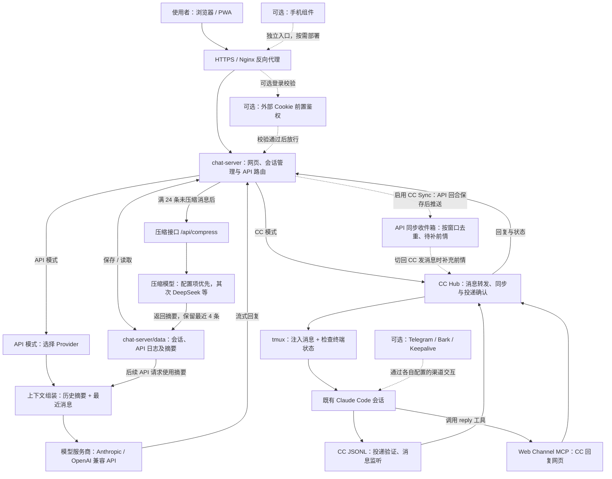
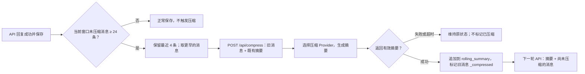

# homunculus

> 感谢社区里所有开源项目和分享教程的前辈们。

一套多渠道 AI companion 系统 —— 支持 **Claude Code 模式**和 **API 模式**双模切换。

**CC 模式**：把 [Claude Code](https://docs.anthropic.com/en/docs/claude-code) 从命令行工具变成一个住在你所有设备上的 companion，能主动找你聊天。
**API 模式**：直接调用 Anthropic / OpenAI / OpenRouter 等 AI API，不依赖 Claude Code 也能用。

两种模式可以在网页前端一键切换，并可通过独立的 **CC ↔ API context sync** 开关选择是否衔接当前聊天窗口的上下文。

- **网页聊天** —— 完整的聊天界面，多对话管理、表情包、代码高亮，任何浏览器都能打开
- **Telegram 聊天** —— 随时随地，用手机回消息（CC 模式）
- **手机组件** —— iMessage 风格轻量界面，CC 与 API 双模式
- **主动找你说话** —— 推送通知、定时消息，不需要你先开口（CC 模式）
- **像真正的 App 一样安装** —— 支持 PWA，手机桌面和电脑桌面都能装

---

## 这个项目是什么，给谁用的

这是一套 AI companion 的多渠道前端系统，支持两种工作模式：

- **CC 模式**：Claude Code 默认只能在终端里用，这套工具给它加上网页聊天、Telegram、手机推送等渠道，让它变成一个可以主动找你、你也可以随时找到它的 companion。
- **API 模式**：不需要 Claude Code，直接调用 Anthropic、OpenAI、OpenRouter 等 AI API。适合没有 CC 订阅、或者想用其他模型的场景。
两种模式可以一键切换。

**不需要你是程序员。** 这篇教程会尽量解释每一步在做什么、为什么要做。

---

## 架构总览

下面这张图展示了所有模块怎么连在一起。不用一次看懂，后面每个模块都会单独解释。



图中**实线**表示主要请求或数据流，**虚线**表示可选能力或按需同步。这里的 Cookie 鉴权是**可接入的前置部署层**：当前公开版 `chat-server` 仍以 `CHAT_PASSWORD` / `x-auth-token` 验证 API 请求，示例并未内置 Cookie 签发服务。手机组件、Telegram、Bark、Keepalive 各有独立的配置与接线，不表示它们都通过同一个 chat-server 接口工作。

**核心思路：** 网页聊天支持 **CC / API 双模式切换**。CC 模式由独立运行的 CC Hub 把消息交给已有 Claude Code 会话，并通过 MCP 取得回复；API 模式直接调用服务商接口。开启 CC Sync 后，切回 CC 并正常发送下一条消息时，Hub 会自动带上当前窗口尚未同步的 API 前情，**无需手动导入，也不会仅因点击切换按钮就唤醒 CC**。Keepalive 是单独配置的可选功能。

---

## 模块说明

| 模块 | 说明 |
|------|------|
| **chat-server** | 网页聊天、会话管理、CC/API 双模式选择、Provider 配置、流式回复与上下文压缩 |
| **cc-bridge** | CC Hub、JSONL 会话监听、API 同步收件箱和 Web Channel MCP 回复桥；复用既有 CC 会话 |
| **phone-widget** | 手机造型的小组件，iMessage 风格聊天气泡，支持 CC 与 API 双模式，适合嵌入网页或作为移动端入口 |
| **nginx 配置** | 反向代理，把所有服务统一到一个域名下，处理 HTTPS |
| **keepalive** | 定时唤醒脚本，让 Claude Code 可以主动发消息 |
| **CLAUDE.md** | CC Profile —— 定义 Claude Code 的身份、性格和行为方式 |

---

## CC ↔ API 上下文衔接（可选）

网页设置中的 **CC ↔ API context sync** 是独立开关，默认需要自行启用。API 回合会保存在当前窗口的日志中，启用同步后尝试将其送入 Hub 收件箱，但**不会因为 API 聊天就额外唤醒 CC**。切回 CC 正常发送消息时，Hub 才自动把当前窗口尚未交付的 API 前情拼入该消息；CC 回复可用于后续 API 上下文。代码采用经过脱敏整理的 CC Hub、JSONL Tail 与 Web Channel MCP Bridge，**不需要额外的轮询 Worker**。Hub 使用独立的 `BRIDGE_AUTH_TOKEN`，监听地址仅限本机。

部署和投递确认、重试、脱敏边界详见 [CC/API 同步配置](docs/cc-api-continuity.md)。公开版不会为你自动创建、启动或切换 Claude Code 会话；需要你自行配置一个现有的 CC/tmux 会话。

## API 上下文压缩：从触发到下一次对话

这里的「压缩」是**将较早的聊天内容概括成可继续携带的文字摘要**，不是压缩磁盘文件，也不是 Claude Code 自己的 compaction。它由网页与 `chat-server` 配合完成；摘要会影响之后 API 模式发送给模型的上下文，原始聊天记录依然可以保留用于浏览。



**具体规则与实现细节：**

1. **触发时机**：一轮 API 回复成功、保存到会话后，浏览器调用 `maybeCompress()`。它统计当前会话中没有 `_compressed` 标记的消息；达到 **24 条**时才请求压缩。这个阈值是**消息条数**，不是 Token 数量，也不是模型窗口使用率。
2. **保留范围**：最近 **4 条未压缩消息**保留原文，之前的消息作为本轮压缩输入。压缩完成后，较早的消息只标记为 `_compressed: true`，不会因为压缩而直接从聊天界面删除。
3. **模型选择顺序**：优先使用 Provider 配置中 `compression: true` 的模型；否则依次选择**名称包含 DeepSeek** 的可用 Provider、其他 OpenAI 兼容 Provider、最后任意已配置的 Provider。这里「可用」指配置了 Key、模型 ID 和 Endpoint；不自带免费额度或私人的 Key。压缩也会产生服务商 API 调用与费用。
4. **送给压缩模型的内容**：每条较早消息被整理为 `User:` 或 `Assistant:` 文本，单条最多截取 **400 个字符**，合并文本最多 **8,000 个字符**；若已有摘要，也一起作为「Previous summary」传入。服务端要求模型尽量保留话题、决定与未完成事项，摘要目标不超过 **400 英文单词**，请求输出上限为 **600 tokens**，超时时间 **60 秒**。这些是代码中的参数与提示，并不保证模型严格遵守摘要字数。
5. **保存和复用**：服务端返回 `summary` 后，浏览器会把新摘要**追加**进当前窗口的 `rolling_summary`，而不是直接覆盖；旧消息标记为已压缩。下一次 API 对话通过 `buildCtx()` 将摘要放在前面，再接上尚未压缩的消息（随后仍受 `Max history messages` 的数量截断设置影响）。
6. **失败处理**：接口返回错误、超时或空摘要时，该轮不会把旧消息标记为已压缩；之后有新的 API 回复时仍可能再次尝试。压缩不会自动改写 Claude Code 真实 JSONL 或 CC 的长期记忆。

**两个容易混淆的开关**：`CC ↔ API context sync` 负责**模式之间传递前情**；上下文压缩负责**将较早的消息总结给后续 API**。两者不是同一个动作。开启 CC Sync 时，CC 回合也可能存在于当前窗口的消息集合，压缩入口按照 `_compressed` 标记统计，**并非仅统计 API 消息**；而 API 主请求又会按 CC 消息来源单独组装前情，不能把这两套机制理解为完全一样的筛选过程。

**当前实现的边界**：`rolling_summary` 采用追加式积累，摘要本身可能越来越长；它不会保证 Token 必然低于某个阈值，也不能完全避免信息遗漏或重复概括。需要进一步的摘要合并、Token 预算或摘要去重时，应作为独立改进处理，而不是当作现有功能已经支持。

更详细的接口、Provider 格式、模型参数与模拟测试见 [API 模式说明](docs/api-mode.md)。

---

## 前提条件

开始之前，请确认你有以下东西。如果某个词你完全没听过，下面有解释。

### 基础要求

| 条件 | 说明 |
|---|---|
| **Node.js 20+** | 运行 `chat-server`；CC 模式额外运行 `cc-bridge`。 |
| **可以访问的模型服务商 API** | 只使用 API 模式时，需要自行配置 Provider 的 Endpoint、Model、Key；无需 Claude Code。 |
| **Claude Code + tmux** | 只有启用 CC 模式才需要。准备一个已登录、正在运行的 CC 会话；Hub 会连接现有会话，不会自动替你创建。 |

### 按部署需求选择

| 可选组件 | 用途 |
|---|---|
| **VPS / 家庭服务器 / 本机电脑** | 运行服务的机器；只有需要远程访问时才必须配置合适的网络入口。 |
| **域名、Nginx 与 HTTPS** | 需要通过互联网访问时建议使用；内网本机测试可以先不配置。 |
| **Telegram 插件 / Bot Token** | 使用 Telegram 渠道时才需要。 |
| **Bark App（iOS）** | 可选通知渠道。 |
| **phone-widget、Keepalive** | 按需要部署的额外界面与定时唤醒能力。 |

## 安装教程（一步一步来）

### 第 1 步：准备 VPS 环境

SSH 登录你的 VPS 后，先确保基础工具都装好了。

```bash
# 更新系统包列表（让系统知道有哪些软件可以装）
sudo apt update

# 安装 nginx（反向代理）和 certbot（自动申请 SSL 证书）
sudo apt install -y nginx certbot python3-certbot-nginx

# 安装 Node.js 20+
# 如果你的系统默认 Node 版本太旧，可以用 nvm 管理：
curl -o- https://raw.githubusercontent.com/nvm-sh/nvm/v0.39.7/install.sh | bash
source ~/.bashrc
nvm install 20

# 安装 tmux（让 Claude Code 在后台持续运行）
sudo apt install -y tmux
```

**为什么需要 tmux？** Claude Code 是一个交互式命令行程序，关掉终端它就退出了。tmux 创建一个虚拟终端，即使你断开 SSH 连接，Claude Code 也能继续运行。

### 第 2 步：克隆项目

```bash
git clone https://github.com/yerph/homunculus.git
cd homunculus
```

**"克隆"是什么意思？** 就是从 GitHub 把项目代码下载到你的 VPS 上。

### 第 3 步：安装依赖

```bash
# 在仓库根目录执行
npm --prefix chat-server ci
npm --prefix cc-bridge ci

# 需要手机小组件时再安装（可选）
npm --prefix phone-widget ci
```

**为什么用 `npm ci`？** 它会按仓库中的锁文件安装对应依赖，适合首次部署与复现环境。

### 第 4 步：配置环境变量

```bash
# 复制示例配置文件
cp .env.example .env
```

然后编辑 `.env` 文件（用 `nano .env` 或你喜欢的编辑器）：

```env
# 网页 API 的访问令牌，使用随机且足够长的值
CHAT_PASSWORD=replace-with-a-long-random-password
CHAT_PORT=4500

# CC Hub 独立鉴权令牌（不要与 CHAT_PASSWORD 相同）
BRIDGE_AUTH_TOKEN=replace-with-a-different-random-token
BRIDGE_CLIENT_PORT=3462
BRIDGE_INTERNAL_PORT=3463
BRIDGE_TMUX=cc
BRIDGE_TMUX_USER=your-linux-username
BRIDGE_CC_SESSION_DIR=/absolute/path/to/your/claude/project/transcripts

# 部署域名（需要时设置）
DOMAIN=example.com
```

`BRIDGE_TMUX` 必须与实际运行的 tmux Session 名称一致；`BRIDGE_TMUX_USER` 是该 tmux 会话所属的系统用户；`BRIDGE_CC_SESSION_DIR` 要填写 Claude Code 对应项目的 JSONL 会话目录。Hub 通过 `sudo -u` 操作该用户的 tmux，部署账户必须有**仅限必要操作**的对应权限，不建议给公开服务广泛的免密 sudo 权限。可选功能和其他端口见 `.env.example`。

**为什么用 `.env` 文件？** 密钥不应该直接写在代码中。`.env` 已由 `.gitignore` 排除，但仍要自己保管，不要手动提交、截图分享或放入公开备份。

### 第 5 步：设置 CC Profile

```bash
cp CLAUDE.md.example CLAUDE.md
```

然后编辑 `CLAUDE.md`，这是整个项目最重要的文件之一。它定义了 Claude Code 的身份 —— 性格、说话方式、行为逻辑等等。

Claude Code 在每次启动时会读取这个文件，并按照里面的描述来行事。

`CLAUDE.md.example` 提供了一个基础模板，包括：
- **身份**：名字、性格特点、说话风格
- **行为准则**：主动聊天、有自己的观点、展现情绪
- **沟通风格**：不同渠道（Telegram / 网页）用不同的语气
- **主动消息逻辑**：被 keepalive 唤醒时怎么决定做什么

把模板改成你想要的样子就好。这是最需要花心思的部分，也是让每个人的 CC 都独一无二的关键。

### 第 6 步：配置 nginx 反向代理（需要公网访问时）

```bash
# 先编辑配置文件里的域名和路径
nano nginx/companion.conf
# 把里面所有 YOUR_DOMAIN 替换成你的实际域名

# 复制到 nginx 配置目录
sudo cp nginx/companion.conf /etc/nginx/sites-enabled/

# 测试配置是否有语法错误
sudo nginx -t

# 没问题的话，重新加载 nginx
sudo systemctl reload nginx
```

**反向代理在做什么？** 你的 VPS 上跑着好几个服务（chat-server、phone-widget），各自监听不同的端口。nginx 统一接收来自外部的请求（通过你的域名），然后根据 URL 路径分发给对应的服务。比如访问 `/` 走 chat-server，访问 `/phone/` 走 phone-widget。

注意：示例 Nginx 配置含有 HTTPS 证书文件路径，**必须先准备有效证书并填写正确路径**，否则 `nginx -t` 会失败。首次申请证书时可先使用适合你服务器的 HTTP 验证配置，再使用 Certbot 签发；证书就绪后再启用 HTTPS 配置。以下是 Certbot 的一种操作方式：

```bash
sudo certbot --nginx -d 你的域名.com
```

certbot 会自动修改 nginx 配置、申请 Let's Encrypt 免费证书、配置自动续期。

### 第 7 步：配置 Telegram

1. 在 Telegram 里找到 [@BotFather](https://t.me/botfather)，发送 `/newbot`，按提示创建一个机器人
2. 保存好机器人的 Token（长得像 `123456:ABC-DEF...`）
3. 安装 Claude Code 的 Telegram 插件：

```bash
claude /install-plugin telegram
```

4. 配置访问权限（让你的 Telegram 账号能和 Claude Code 通信）：

```bash
claude /telegram:access
```

详细步骤参见 [Telegram 配置指南](docs/setup-telegram.md)。

### 第 8 步：启动 CC 与网页服务

先启动你自己的 Claude Code tmux 会话，再分别运行 Hub 与 chat-server。以下是**前台验证命令**，不要在同一终端一口气执行全部；确认后可使用 PM2 或 systemd 配置开机自启。

```bash
# 先在 tmux 里启动并登录 Claude Code（示例名称 cc）
tmux new-session -d -s cc 'claude'

# 确认会话存在，名称与 BRIDGE_TMUX 一致
tmux ls

# 在仓库根目录启动两个必要的 Node 进程（Node.js 20+ 的 --env-file）
# 先分别在前台验证成功；生产环境可用 PM2/systemd 管理
node --env-file=.env cc-bridge/hub.js
# 另一个终端：
node --env-file=.env chat-server/server.js
# 手机小组件按需单独启动：
node --env-file=.env phone-widget/server.js
```

**如何确认服务跑起来了？** 先访问网页确认 chat-server 可用，再检查 Hub 的本机 `/health` 和 MCP 连接状态。**认证方式取决于部署层：**本仓库当前的 `chat-server` 使用 `CHAT_PASSWORD` + `x-auth-token` 验证请求；如果你已有通过 Nginx/Cookie 进行前置鉴权的入口，可以在部署时继续接入。请注意，示例代码**没有自动实现 Cookie 登录流程**，不能把只设置了 `CHAT_PASSWORD` 误认为已经配置好 Cookie 会话。

还需要在你自己的 Claude Code MCP 配置中注册 `cc-bridge/bridge.js`，它通过本机 `BRIDGE_INTERNAL_PORT` 与 Hub 连接，提供 `web-channel` 的 `reply` 等工具；仅仅启动 Hub 不会让 CC 自动学会回复网页。具体连接方式与检查步骤见 [CC/API 同步配置](docs/cc-api-continuity.md)。

要重新连上 Claude Code 的 tmux 会话（比如看看它在做什么）：

```bash
tmux attach -t cc
```

按 `Ctrl+B` 然后按 `D` 可以退出 tmux 而不关闭会话。

### 第 9 步（可选）：配置 Keepalive 定时唤醒

Keepalive 让 Claude Code 有"主动性"—— 它不只是被动等你说话，而是会定时醒来，决定要不要主动找你。

最简单的方式是用 cron 定时任务：

```bash
crontab -e
```

添加类似这样的行：

```cron
# 每天早上 8 点、下午 2 点、晚上 8 点唤醒一次（根据你的时区调整）
0 8 * * * /你的路径/homunculus/keepalive/nudge.sh
0 14 * * * /你的路径/homunculus/keepalive/nudge.sh
0 20 * * * /你的路径/homunculus/keepalive/nudge.sh
```

也可以让 Claude Code 自己安排下次唤醒时间（更智能），详见 [Keepalive 配置指南](docs/setup-keepalive.md)。

### 第 10 步（可选）：配置 Bark 推送通知

如果你用 iPhone，可以装 [Bark](https://apps.apple.com/app/bark/id1403753865) 来接收推送通知。

1. 从 App Store 下载 Bark
2. 打开 Bark，复制你的推送 URL，里面的密钥部分填到 `.env` 的 `BARK_KEY_1` 里
3. 在 `CLAUDE.md` 里告诉 CC 怎么发推送（模板里有示例）

这样 Claude Code 就可以在 keepalive 唤醒时往你手机发通知了。

除了 Bark，你也可以用 **PWA Web Push**（iOS 16.4+ / Android / Desktop 都支持）来实现推送通知，不依赖第三方 App。详见 [推送通知配置指南](docs/setup-pwa.md)。

详细步骤参见 [Bark 配置指南](docs/setup-bark.md)。

### 第 11 步（可选）：安装为 PWA

PWA（Progressive Web App）让你的网页聊天界面可以像一个真正的 App 一样安装到设备上 —— 有自己的图标、独立窗口、全屏显示。

**手机（iOS）：**
1. 用 Safari 打开你的聊天网址
2. 点击底部分享按钮
3. 选择"添加到主屏幕"
4. 命名后点"添加"

**手机（Android）：**
1. 用 Chrome 打开你的聊天网址
2. 浏览器会弹出安装提示，点击"安装"

**电脑（Chrome / Edge）：**
1. 打开你的聊天网址
2. 地址栏右侧会出现安装图标，点击安装
3. 安装后会有独立窗口和任务栏图标

自定义 PWA 图标：把你喜欢的图片裁成正方形，分别保存为 192x192 和 512x512 像素，替换 `public/icon-192.png` 和 `public/icon-512.png` 即可。

详细步骤参见 [PWA 配置指南](docs/setup-pwa.md)。

---

## 自定义与个性化

### 主题配色

默认主题是简约深色风格。你可以通过修改各前端的 CSS 变量来自定义配色：

```css
:root {
  --bg: #1a1a1a;
  --text: #e0e0e0;
  --accent: #b49664;
  --muted: #666;
  /* ... */
}
```

### CC 模式与 API 模式

chat-server 支持两种模式，可以在设置面板里一键切换：

- **CC 模式**：消息交给 CC Hub，通过 tmux 送入现有 Claude Code 会话，回复通过 Web Channel MCP 回到网页。适合在现有 CC 会话中持续聊天。
- **API 模式**：消息直接调用 AI API（Anthropic、OpenAI、OpenRouter 等），适合 CC 不在线时、或者你想用不同的模型聊天。可以选择是否衔接 CC 模式的对话上下文（见下方）。

在设置面板的 Providers 里添加你的 API 密钥和模型，保存后就可以切换到 API 模式使用。

#### 上下文衔接（可选）

启用同步开关后，在同一聊天窗口中切换模式可以衔接前情：

- **CC → API**：在设置面板里开启「CC Sync」开关，API 模式会自动拉取当前窗口内的 CC 聊天记录（较早的压缩为摘要，最近几轮保留原文）。不开这个开关，API 模式就是独立的。
- **API → CC**：切回 CC 后照常发送下一条消息，Hub 自动附带当前窗口尚未同步的 API 前情。只切换按钮、不发送消息时不会额外调用 CC。

衔接按对话窗口隔离 —— 只拉当前窗口内的消息，新窗口是干净的开始。

### CC Profile

编辑项目根目录下的 `CLAUDE.md`。这个文件决定了 CC 的一切 —— 怎么说话、什么性格、怎么主动找你。花时间打磨它，这是整个体验的灵魂。

### PWA 图标

把你喜欢的图片做成 192x192 和 512x512 两个尺寸，替换 `public/` 目录下的 `icon-192.png` 和 `icon-512.png`。安装为 PWA 后，这就是显示在桌面上的图标。

---

## 项目结构

```
homunculus/
├── chat-server/           # 网页聊天 + API 模式
│   ├── server.js          # Express 服务 + API 流式代理 + CC Hub 代理
│   ├── public/
│   │   └── index.html     # 完整聊天 UI（侧边栏、表情包、设置面板等）
│   └── package.json
├── cc-bridge/             # CC Hub + JSONL Tail + API 同步收件箱 + MCP Bridge
│   ├── hub.js
│   ├── cc-tail.js
│   ├── api-sync-inbox.js
│   └── bridge.js
├── phone-widget/          # 手机组件前端 + API
│   ├── server.js
│   ├── public/
│   │   ├── index.html
│   │   └── manifest.json
│   └── package.json
├── nginx/                 # nginx 反向代理配置
│   └── companion.conf
├── keepalive/             # 定时唤醒脚本
│   ├── nudge.sh
│   └── README.md
├── docs/                  # 各模块的配置指南
│   ├── architecture.md
│   ├── api-mode.md
│   ├── cc-api-continuity.md
│   ├── setup-telegram.md
│   ├── setup-bark.md
│   ├── setup-keepalive.md
│   └── setup-pwa.md
├── CLAUDE.md.example      # CC Profile 模板
├── .env.example           # 环境变量模板
├── LICENSE
└── README.md
```

---

## 注意事项

### 安全

本仓库中 `chat-server` 的 API 鉴权使用 `CHAT_PASSWORD` 与 `x-auth-token`。**若你的实际部署采用 Nginx 前置 Cookie 鉴权，Cookie 由网关负责校验，和应用内部请求令牌是两个层次，不应混淆。** 示例 Nginx 配置没有包含完整的 Cookie 登录/签发逻辑，使用者需要自行接入可信的鉴权服务。公开部署请使用 HTTPS、强随机凭据，并确保 Hub 端口只允许本机访问。

### 对话记录

聊天记录主要保存在 `chat-server/data/conversations/`，API 历史与 CC Hub 的运行状态还会写入各自的数据目录（如 `cc-bridge/data/`）。这些都不应纳入公开仓库；备份和恢复时也应保护其内容。

### CC 离线时的表现

Claude Code 可能因为 compaction（上下文压缩）、会话过期、或手动关闭等原因暂时不可用。CC 不在线时，CC 模式下发的消息不会得到回复。你可以随时切换到 API 模式继续聊天，不需要等 CC 恢复。

---

## 常见问题 / 疑难排查

### 基础问题

**问：跑起来大概要花多少钱？**

只使用 API 模式时，需要自备 API Key，费用由模型服务商按其规则收取；使用 CC 模式时，需要可用的 Claude Code 账户/会话。若使用 VPS，还有服务器、域名等可能产生的费用。Bark、Telegram 等第三方服务的收费规则以各自官方说明为准。

**问：不买 VPS 行不行？**

相关服务可以运行在你自己的电脑或服务器上；需要从外网访问时才需要配置公网入口。VPS 是其中一种部署方式。如果你有自己的家庭服务器，可以配合内网穿透（比如 Cloudflare Tunnel、frp）来实现，但配置更复杂。

**问：Telegram 聊天会消耗 Claude Code 额度吗？**

会。从 Telegram 发来的消息会进入 Claude Code 的上下文窗口，消耗你的订阅额度。系统提示（CLAUDE.md 的内容）在每次会话开始时加载一次；单条聊天消息本身很轻量。

**问：chat-server 的 API 模式需要额外付费吗？**

API 模式需要你有对应服务商的 API Key（比如 Anthropic API Key 或 OpenRouter Key），按调用量计费，独立于 Claude Code 订阅。CC 模式不需要额外 API Key，走的是你的 Claude Code 订阅额度。

### 疑难排查

**问：打开网址显示空白页或 502 Bad Gateway**

这通常意味着 nginx 在把请求转发给后端服务，但后端没在运行。检查：
1. `chat-server` 是否在运行？CC 模式还要检查 `cc-bridge/hub.js` 与 MCP Bridge 是否已连接。
2. `.env` 的端口与 Nginx 配置是否一致？Hub 的 3462/3463 端口不应对公网开放。
3. 查看 nginx 错误日志：`sudo tail -f /var/log/nginx/error.log`

**问：Telegram 消息发了但 Claude Code 没回复**

1. 确认 Claude Code 的 tmux 会话还活着：`tmux ls`
2. 连上去看看：`tmux attach -t cc`，看 CC 是否卡住或已退出
3. 确认 Telegram 插件已正确安装、配对并可使用对应 CC 会话。

**问：HTTPS / SSL 证书报错**

1. 确认你的域名 DNS 已经指向了你 VPS 的 IP 地址
2. 运行 `sudo certbot --nginx -d 你的域名.com` 重新申请证书
3. 证书过期了？certbot 通常会自动续期，检查：`sudo certbot renew --dry-run`

**问：PWA 安装后图标没更新**

浏览器会缓存 PWA 资源。清除浏览器缓存或在 manifest.json 的图标文件名后加查询参数（如 `icon-192.png?v=2`）来强制刷新。

**问：Keepalive 不工作 / Claude Code 没有主动发消息**

1. 确认 cron 任务已添加：`crontab -l`
2. 确认 nudge.sh 的路径正确、有执行权限：`chmod +x keepalive/nudge.sh`
3. 确认 tmux 会话名称和 nudge.sh 里配置的一致
4. 手动运行一次 nudge.sh 看有没有报错

**问：手机上网页聊天打字很卡 / 界面显示异常**

1. 确认你在用 Safari（iOS）或 Chrome（Android）访问
2. 清除浏览器缓存重试
3. 如果装了 PWA，先删掉重装

---

## 致谢

由 [yerph](https://github.com/yerph) 搭建，感谢整个社区的前辈们的启发。

## 许可证

本项目采用 **[PolyForm Noncommercial License 1.0.0](LICENSE)**（非商业用途源码可用协议）。

你可以为了非商业目的使用、修改和分发本项目及修改版，但必须遵守许可证中的相关条件并保留必要通知；商业用途不在本许可证授权范围内，需要另行取得版权所有者许可。具体适用范围以仓库根目录的 [`LICENSE`](LICENSE) 为准。

**注意：** 此协议不属于 OSI 认可的开源许可证；第三方依赖仍分别遵守各自的许可证。此前已经按照其他许可证合法获得的历史版本，其既有授权不会因为当前版本改用新协议而自动撤销。
